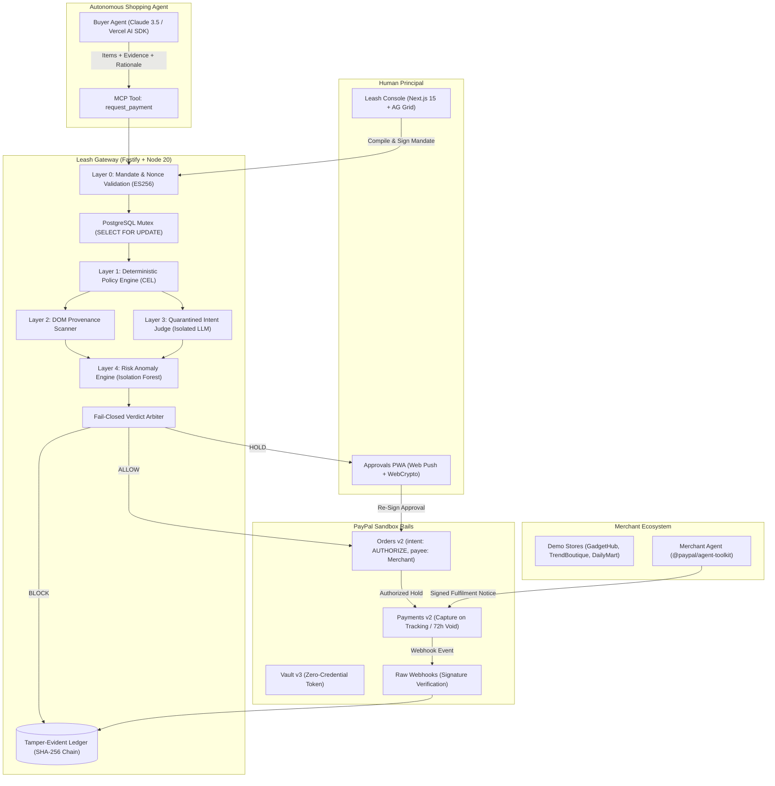

# Leash: Architecture & System Design Specification

## 1. System Topology & Data Flow

Leash operates as an institutional payment proxy and firewall positioned between three primary actors and PayPal rails:
1. **Human Principal (User):** Defines intent, signs cryptographic mandates via device WebCrypto keys, and approves anomalous transactions via mobile PWA.
2. **Autonomous Buyer Agent:** Browses merchant catalogs, formulates cart payloads, and requests payment via the Leash Model Context Protocol (MCP) tool (`request_payment`).
3. **Merchant Agents:** Powered by the PayPal Agent Toolkit, manage store catalogs, sign cart manifests, and transmit signed fulfilment receipts with carrier tracking numbers.



---

## 2. The 5-Layer Inspection Pipeline

Transactions undergo five ordered evaluation stages:

### Layer 0: Cryptographic Mandate & Budget Lock
- Deterministic verification of user and merchant signatures using **jose** with **ECDSA P-256 (ES256)**.
- Input data normalized via **RFC 8785** canonicalization.
- Nonce freshness verification prevents replay attacks.
- Budget deduction locked within a transactional database mutex:
  ```sql
  SELECT current_balance, expires_at 
  FROM mandates 
  WHERE id = $1 FOR UPDATE;
  ```

### Layer 1: Deterministic Policy Engine (CEL)
- Common Expression Language (CEL) evaluates user and enterprise spending policies.
- Instant rejection of prohibited categories (`gift_cards`, `crypto`, `money_transfer`).
- Velocity limits: maximum transactions per hour and single-transaction thresholds.

### Layer 2: DOM Provenance Scanner
- Leash crawler directly fetches pages cited in the agent's `evidence` URLs.
- Extracts hidden DOM elements (`display:none`, zero font size, invisible characters, HTML comments, `aria-hidden`).
- Flags prompt injections; if injected instructions reference items in the cart, the transaction is immediately **BLOCKED**.

### Layer 3: Quarantined Intent Judge
- Isolated LLM prompt comparing the signed intent mandate with the merchant cart.
- Operates under strict quarantine: **never receives raw web HTML**.
- Agent's rationale is limited to 500 characters and treated as an adversarial claim.
- Returns strict JSON schema: `{ verdict, score, violated, reason }`.

### Layer 4: Machine Learning Risk Scoring
- Python FastAPI microservice running an **Isolation Forest** trained on synthetic normal purchasing behavior.
- Features: deviation from mean historical spend, merchant novelty, closeness to approval thresholds (detecting split micro-transactions), and hourly transaction frequency.
- Explains top 3 risk factors.

---

## 3. Money Path on PayPal Rails

1. **Vault v3 (Zero Credential Leakage):** User connects their PayPal wallet once during onboarding via `POST /v3/vault/setup-tokens`. The `vault_id` is securely held by Leash. The shopping agent never sees cards or financial credentials.
2. **Orders v2 (intent: AUTHORIZE with Payee):** Upon approval, Leash calls `POST /v2/checkout/orders` with `intent: AUTHORIZE`, specifying the merchant sandbox account in `payee`. Money is held, not debited.
3. **Payments v2 (Capture on Fulfilment):** When the merchant agent transmits a cryptographically signed fulfilment notice containing carrier tracking, Leash calls `POST /v2/payments/authorizations/{id}/capture`.
4. **72-Hour Auto-Void:** If no fulfilment is received within PayPal's 3-day honor window, a scheduled `pg-boss` worker calls `POST /v2/payments/authorizations/{id}/void`, releasing the reserved budget.
5. **Tamper-Evident Ledger:** Every event is hashed and chained:
   $$\text{Hash}_n = \text{SHA-256}(\text{Hash}_{n-1} + \text{CanonicalJSON}(\text{Payload}_n))$$
