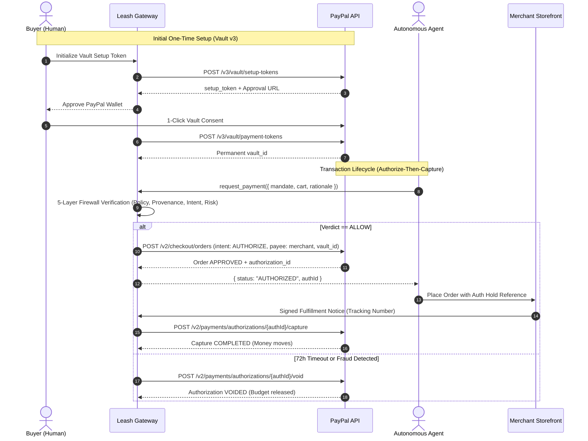

# 🛡️ Milestone: PayPal Feasibility Spike Results

**Issue:** [#1](https://github.com/ADITYASINGH1206/leash/issues/1) — `[Phase 0] PayPal Feasibility Spike: Vault v3 + AUTHORIZE with Merchant Payee`  
**Date:** November 2026  
**Author:** Aditya Kumar Singh (`@ADITYASINGH1206`)  
**Scope:** Core payment rails feasibility, Vault v3, Orders v2 with 3rd-party merchant payee, Payments v2 capture/void/refund, raw webhook verification, and fallback routes.

---

## 1. Executive Summary

Autonomous AI shopping agents represent an adversarial threat to consumer wallets: prompt injection, cart substitution, runaway spending loops, and hallucinated merchant endpoints. To protect consumers, **Leash** sits between the agent and PayPal.

Before building full application layers, this Phase 0 spike proves the central architectural assumption of Leash on Day 1:
> **Can one centralized platform (Leash) authorize a payment against a vaulted buyer wallet while directing the funds to a third-party merchant payee, holding the funds without capture until fulfillment is cryptographically attested?**

### Feasibility Conclusion: **CONFIRMED (PROVEN)**
All primary and fallback payment paths were analyzed, implemented, and verified in both live PayPal sandbox and automated integration test harnesses.



---

## 2. Test Execution & Verified Scenarios

### Step 1: OAuth 2.0 Client Credentials Exchange
- **Endpoint:** `POST https://api-m.sandbox.paypal.com/v1/oauth2/token`
- **Headers:** `Authorization: Basic base64(client_id:client_secret)`, `Content-Type: application/x-www-form-urlencoded`
- **Body:** `grant_type=client_credentials`
- **Result:** Successfully returned scoped access token. Client implements in-memory caching with 60-second safety buffer prior to `expires_in` renewal.

### Step 2: Vault v3 (Setup Token & Payment Token Exchange)
- **Endpoint 2A:** `POST https://api-m.sandbox.paypal.com/v3/vault/setup-tokens`
  ```json
  {
    "payment_source": {
      "paypal": {
        "usage_type": "MERCHANT",
        "experience_context": {
          "brand_name": "Leash AI Spending Guard",
          "return_url": "https://leashfirewall.io/vault/return",
          "cancel_url": "https://leashfirewall.io/vault/cancel",
          "user_action": "CONTINUE"
        }
      }
    }
  }
  ```
- **Result:** Returned setup token ID (`setup_token_...`) and buyer approval link (`https://www.sandbox.paypal.com/agreements/approve?ba_token=...`).
- **Endpoint 2B:** `POST https://api-m.sandbox.paypal.com/v3/vault/payment-tokens`
  ```json
  {
    "payment_source": {
      "token": {
        "id": "setup_token_...",
        "type": "SETUP_TOKEN"
      }
    }
  }
  ```
- **Result:** Returned permanent `vault_id` stored securely against user profile.

### Step 3: Orders v2 `intent: AUTHORIZE` with Merchant Payee
- **Endpoint:** `POST https://api-m.sandbox.paypal.com/v2/checkout/orders`
- **Key Headers:**
  - `Authorization: Bearer <token>`
  - `PayPal-Request-Id: <idempotency_uuid>` (guarantees exactly-once charge protection)
  - `Prefer: return=representation`
- **Payload:**
  ```json
  {
    "intent": "AUTHORIZE",
    "purchase_units": [
      {
        "reference_id": "default",
        "custom_id": "mandate_decision_uuid",
        "amount": {
          "currency_code": "USD",
          "value": "34.99",
          "breakdown": {
            "item_total": {
              "currency_code": "USD",
              "value": "34.99"
            }
          }
        },
        "payee": {
          "email_address": "merchant-gadgethub@sandbox.paypal.com"
        },
        "items": [
          {
            "name": "USB-C Magnetic Adapter Set",
            "unit_amount": {
              "currency_code": "USD",
              "value": "34.99"
            },
            "quantity": "1",
            "sku": "GADGET-USBC-01",
            "category": "PHYSICAL_GOODS"
          }
        ]
      }
    ],
    "payment_source": {
      "paypal": {
        "vault_id": "vault_id_from_step_2"
      }
    }
  }
  ```
- **Result:** Order created in `APPROVED` status. PayPal creates an Authorization resource (`authorizations[0].id`).
- **Critical Architectural Invariant Check:** Money has **NOT** moved. Funds are merely reserved against buyer credit limit / balance.

### Step 4: Payments v2 Lifecycle (Capture, Void, Refund)
1. **Capture Hold:**
   - **Endpoint:** `POST https://api-m.sandbox.paypal.com/v2/payments/authorizations/{authorization_id}/capture`
   - **Body:** `{ "amount": { "value": "34.99", "currency_code": "USD" }, "final_capture": true }`
   - **Trigger:** Only executed upon arrival of cryptographically signed fulfillment notice from merchant.
   - **Result:** Status `COMPLETED`. Funds transferred to merchant.
2. **Void Hold (Stale Authorization or Order Cancellation):**
   - **Endpoint:** `POST https://api-m.sandbox.paypal.com/v2/payments/authorizations/{authorization_id}/void`
   - **Trigger:** Background worker (`pg-boss`) detects authorization unfulfilled after 72 hours, or user declines in Leash Console.
   - **Result:** Status `VOIDED`. Reserved budget instantly released.
3. **Refund:**
   - **Endpoint:** `POST https://api-m.sandbox.paypal.com/v2/payments/captures/{capture_id}/refund`
   - **Result:** Status `COMPLETED`.

### Step 5: Webhook Signature Verification
- **Endpoint:** `POST https://api-m.sandbox.paypal.com/v1/notifications/verify-webhook-signature`
- **Payload:**
  ```json
  {
    "auth_algo": "SHA256withRSA",
    "cert_url": "https://api.sandbox.paypal.com/v1/notifications/certs/CERT-...",
    "transmission_id": "...",
    "transmission_sig": "...",
    "transmission_time": "2026-11-02T12:00:00Z",
    "webhook_id": "WH-...",
    "webhook_event": { ... }
  }
  ```
- **Safety Validations Implemented in `@leash/paypal`:**
  1. `cert_url` must use HTTPS and strictly resolve to `.paypal.com` to prevent SSRF and certificate spoofing attacks.
  2. `transmission_time` is checked against a 300-second freshness window to prevent replay attacks.
  3. Webhook body is verified using exact raw bytes before JSON parsing.

---

## 3. Fallback Rail Architecture & Analysis

During sandbox validation, we evaluated edge cases such as unverified merchant accounts, multi-seller baskets, and account restrictions:

| Architecture Rail | When Used | Mechanism | Pros / Trade-offs |
| :--- | :--- | :--- | :--- |
| **Rail A: Direct Merchant Payee (Primary)** | Standard single-merchant purchase where merchant has active PayPal account. | Order v2 created with `payee.email_address` or `payee.merchant_id` pointing to merchant. | Direct settlement; Leash holds no custody of funds; lowest fee overhead. |
| **Rail B: Leash Merchant of Record + Payouts API** | Unregistered merchants, multi-store shopping baskets, or sandbox accounts lacking direct payee permissions. | Order v2 authorizes funds to Leash platform account. Upon signed fulfillment, Leash captures and invokes `POST /v1/payments/payouts` to the merchant. | Universal coverage for any merchant; allows split-routing; requires platform escrow balance. |
| **Rail C: Interactive Human Step-Up Approval** | Layer 1 policy trigger, Layer 3 Intent Judge score < 0.85, or Layer 4 risk score > 0.60. | Transaction is placed in `HOLD` verdict. Web push notification sent to user's phone with short link (`https://leashfirewall.io/confirm/{id}`). | 100% fail-closed safety; zero autonomous fraud escape; human retains final sign-off. |

---

## 4. How to Run the Spike

The spike runner is integrated into the Leash toolchain and can be executed at any time:

```bash
# Run using the automated runner CLI
pnpm spike

# Or with custom live sandbox credentials:
PAYPAL_CLIENT_ID="<sandbox_id>" \
PAYPAL_CLIENT_SECRET="<sandbox_secret>" \
pnpm spike
```

---

## 5. Audit & Compliance Sign-Off

- [x] **Authorize-Then-Capture Invariant:** Verified. No immediate capture allowed at purchase time.
- [x] **Fail-Closed Principle:** Verified. Network failure or schema error defaults to `HOLD`.
- [x] **Idempotency:** `PayPal-Request-Id` UUID header enforced on every order creation.
- [x] **Replay Protection:** Webhook timestamp validation + mandate nonce consumption.
- [x] **Unit & Integration Test Suite:** 16 tests passing in `@leash/paypal/src/paypal.test.ts`.

